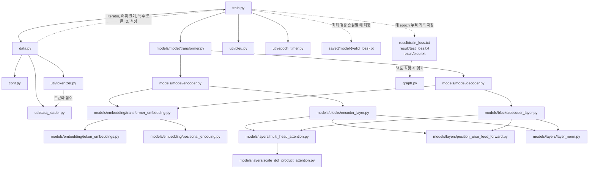
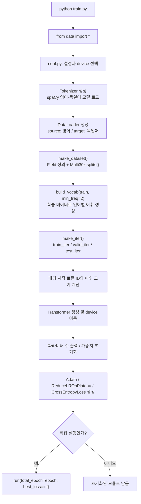
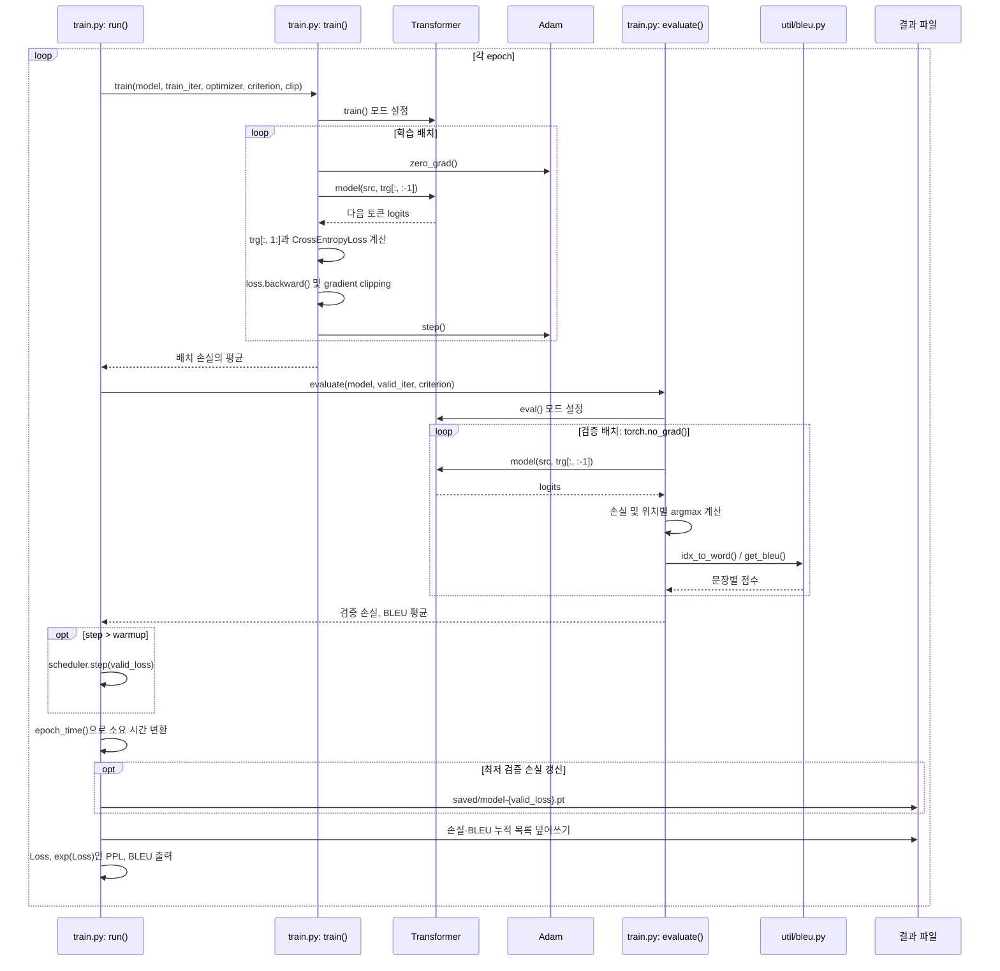
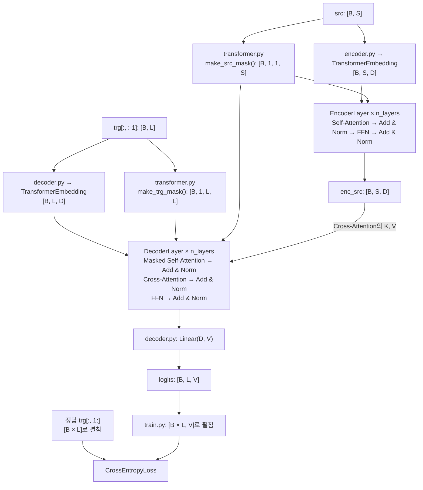

# train.py에서 시작하는 프로젝트 분석

이 프로젝트는 Multi30k의 영어 문장을 독일어로 번역하는 PyTorch Encoder–Decoder Transformer를 구현한다. `train.py`가 데이터 준비, 모델 생성, 학습·검증, 결과 저장을 연결한다. 아래 설명은 현재 저장소의 실제 코드를 기준으로 한다.

파일 사이의 의존 관계에는 Mermaid `flowchart`, 학습 중 호출 순서에는 `sequenceDiagram`을 사용했다. Mermaid를 지원하는 Markdown 뷰어에서 차트를 볼 수 있다.

## 1. train.py를 중심으로 본 파일 연결

실선은 **import하는 파일 → import되는 파일**, 점선은 **값이나 결과의 전달 방향**이다. 외부 라이브러리는 이 차트에서 생략했다.

`train.py`는 `from data import *`, `data.py`는 `from conf import *`를 사용한다. 따라서 `train.py`가 쓰는 `device`, `epoch`, `d_model`, `torch` 등은 `data.py`를 거쳐 간접적으로 들어온다. 두 파일에 `__all__`이 없으므로 밑줄로 시작하지 않는 이름이 함께 노출된다.

Encoder와 Decoder는 같은 임베딩 클래스와 레이어 클래스를 사용하지만 각각 객체를 생성한다. 차트에서 같은 파일을 가리키는 것은 **구현 코드의 재사용**이며, 파라미터 공유를 뜻하지 않는다. 각 패키지의 `__init__.py`에는 학습을 연결하는 별도 로직이 없다.

## 2. 실행 시작과 데이터 준비

`data.py`의 데이터 준비와 `train.py`의 모델·옵티마이저 생성은 모듈 최상위에 있다. 따라서 다른 코드에서 `import train`만 해도 실행되며, `if __name__ == '__main__'`이 보호하는 부분은 마지막 `run()` 호출뿐이다.

| 파일 | 담당 기능 | 다음 단계에 전달하는 값 |
| --- | --- | --- |
| `conf.py` | 모델 크기, 배치 크기, 학습 설정, CUDA/CPU 선택 | `device`, `batch_size`, `d_model`, `n_layers`, `epoch` 등 |
| `util/tokenizer.py` | `en_core_web_sm`, `de_core_news_sm`을 로드하고 문자열을 토큰 목록으로 변환 | `tokenize_en`, `tokenize_de` |
| `util/data_loader.py` | legacy torchtext의 `Field`, `Multi30k`, `BucketIterator` 연결 | 데이터 분할, 어휘, 배치 iterator |
| `data.py` | 위 구성요소를 실제로 실행하고 학습 입력 준비 | iterator, `loader`, 어휘 크기, 특수 토큰 ID |

`Field`는 소문자 변환과 `<sos>`, `<eos>` 추가를 설정하며 `batch_first=True`이므로 배치의 텐서 형태는 `[배치 크기, 문장 길이]`이다. 현재 `ext=('.en', '.de')`이므로 영어 → 독일어 방향이다. `test_iter`도 생성하지만 `run()`은 `train_iter`와 `valid_iter`만 사용한다.

현재 주요 기본값은 배치 크기 128, 모델 차원 512, Encoder·Decoder 각각 6개 레이어, attention head 8개, FFN 은닉 차원 2048, 최대 위치 인코딩 길이 256, epoch 1000이다. `max_len`은 위치 인코딩의 크기이며 데이터 로더에서 문장을 잘라주는 설정은 아니다.

## 3. 한 epoch의 학습·검증 순서

학습은 정답의 앞부분을 입력으로 제공하는 **teacher forcing** 방식이다. 예를 들어 정답이 `[<sos>, ich, lerne, <eos>]`이면 Decoder 입력은 `[<sos>, ich, lerne]`, 손실 계산의 정답은 `[ich, lerne, <eos>]`이다. 검증도 같은 방식으로 정답 앞부분을 사용하므로, 시작 토큰부터 번역문을 스스로 생성하는 추론 루프는 아니다.

`initialize_weights()`는 `weight`가 있고 2차원 이상인 모듈에 Kaiming 균등 초기화를 적용한다. `train()`은 역전파 후 `clip_grad_norm_()`으로 기울기 norm을 제한하고 Adam으로 파라미터를 갱신한다. `evaluate()`는 파라미터를 갱신하지 않는다.

## 4. Transformer 내부의 데이터 흐름

아래는 import 관계가 아니라 **forward 연산의 흐름**이다. `B`는 배치 크기, `S`는 원문 길이, `T`는 `<sos>`·`<eos>`를 포함한 정답 길이, `L=T-1`, `D=d_model`, `V=dec_voc_size`이다.

Encoder의 Self-Attention은 같은 입력을 Q, K, V로 사용한다. Decoder의 Self-Attention도 Decoder 쪽 입력을 Q, K, V로 사용하지만 미래 위치를 가린다. Cross-Attention은 Decoder의 중간 출력을 Q로, Encoder 출력을 K와 V로 사용하여 원문을 참조한다.

각 attention 및 FFN 뒤에는 dropout, 잔차 더하기, LayerNorm 순서가 적용된다. 즉 정규화가 잔차 합산 뒤에 오는 구조다. 마지막 Linear는 어휘별 logits를 반환하며 별도의 출력 softmax는 없다. 손실 함수가 필요한 log-softmax 처리를 포함한다.

## 5. 재사용되는 세부 파일

| 파일 | 핵심 클래스 | 실제 연산 |
| --- | --- | --- |
| `models/embedding/transformer_embedding.py` | `TransformerEmbedding` | 토큰 임베딩과 위치 인코딩을 더한 뒤 dropout |
| `models/embedding/token_embeddings.py` | `TokenEmbedding` | `nn.Embedding`으로 토큰 ID를 D차원 벡터로 변환; `padding_idx=1` 고정 |
| `models/embedding/positional_encoding.py` | `PositionalEncoding` | sin/cos 위치 인코딩을 미리 만들고 입력 길이만큼 반환 |
| `models/layers/multi_head_attention.py` | `MultiHeadAttention` | Q/K/V 선형 변환 → head 분할 → attention → head 병합 → 출력 선형 변환 |
| `models/layers/scale_dot_product_attention.py` | `ScaleDotProductAttention` | `QKᵀ / sqrt(D/head)` → mask 적용 → softmax → V와 행렬곱 |
| `models/layers/position_wise_feed_forward.py` | `PositionwiseFeedForward` | Linear(D, hidden) → ReLU → dropout → Linear(hidden, D) |
| `models/layers/layer_norm.py` | `LayerNorm` | 마지막 차원의 평균·분산으로 정규화한 뒤 학습 가능한 gamma, beta 적용 |
| `util/bleu.py` | 함수 모음 | ID를 단어로 복원하고 n-gram 통계·길이 페널티로 점수 계산 |
| `util/epoch_timer.py` | `epoch_time()` | 경과 시간을 분·초로 변환 |

Multi-head attention에서 `[B, 길이, D]`는 `[B, head, 길이, D/head]`로 바뀐다. 기본값에서는 각 head의 차원이 `512 / 8 = 64`이다. 연산 후 다시 `[B, 길이, D]`로 합친다. 따라서 모델 차원은 head 수로 나누어떨어져야 한다.

## 6. 저장 결과와 graph.py의 연결

| 저장 경로 | 저장 조건·내용 | 소비하는 코드 |
| --- | --- | --- |
| `saved/model-{valid_loss}.pt` | 검증 손실이 기존 최저값보다 낮으면 `model.state_dict()` 저장 | 현재 학습 경로에는 재로딩 코드 없음 |
| `result/train_loss.txt` | 매 epoch 학습 손실 누적 목록 | `graph.py`의 `draw('loss')` |
| `result/test_loss.txt` | 이름과 달리 **검증 손실** 누적 목록 | `graph.py`의 `draw('loss')` |
| `result/bleu.txt` | 검증 BLEU 누적 목록 | `graph.py`의 `draw('bleu')` |

`graph.py`는 `train.py`에서 호출하거나 import하지 않는다. 별도로 실행하면 결과 텍스트를 읽어 matplotlib으로 그래프를 표시한다. 저장 경로는 작업 디렉터리 기준 상대 경로이고, 학습 코드가 `saved/`와 `result/`를 생성하지 않으므로 저장 전에 디렉터리가 있어야 한다. 체크포인트에는 optimizer·scheduler 상태가 포함되지 않는다.

## 7. 현재 구현을 해석할 때 주의할 점

다음은 일반적인 Transformer 설명과 구분해야 하는 현재 코드의 특징이다.

1. **패딩 ID 연결:** 손실 함수는 목표 토큰을 평가하면서 `ignore_index=src_pad_idx`를 사용한다. 목표 패딩을 올바르게 제외하려면 `trg_pad_idx`와 같아야 한다. 임베딩의 `padding_idx`도 1로 고정되어 있다.
2. **목표 마스크의 축:** `make_trg_mask()`는 패딩 조건을 `[B, 1, L, 1]`로 만든 뒤 하삼각 마스크와 결합한다. 따라서 패딩 조건은 query 행에 걸린다. 원문 마스크 `[B, 1, 1, S]`처럼 key 열의 패딩을 가리는 형태와는 다르다.
3. **BLEU 입력 구조 불일치:** `evaluate()`는 `get_bleu(output_words.split(), trg_words.split())`처럼 단어 목록을 넘긴다. 하지만 `get_bleu()`는 바깥쪽 목록을 문장 모음처럼 순회하여 각 원소를 `bleu_stats()`에 전달한다. 현재 연결에서는 단어 문자열 내부의 문자 n-gram을 비교하게 되므로 표준적인 단어 단위 문장·코퍼스 BLEU로 해석하면 안 된다.
4. **BLEU 예외와 평균:** 문장별 계산은 고정된 `range(batch_size)`를 돌고 모든 예외를 무시한다. 작은 마지막 배치의 범위 초과도 숨겨지며, 성공한 계산이 하나도 없으면 이후 평균에서 0으로 나누게 된다. 손실과 BLEU 모두 배치 평균을 다시 평균하므로 전체 유효 토큰 수나 문장 수로 가중한 평균과 다를 수 있다.
5. **warmup의 의미:** `step > warmup`일 때만 scheduler를 호출한다. 학습률을 점진적으로 올리는 warmup 구현은 아니다. 기본값 100이면 0부터 시작하는 `step=101`, 즉 102번째 epoch 종료 후부터 호출한다.
6. **실행 의존성:** 데이터 준비에는 `torchtext.legacy` API와 spaCy 언어 모델이 필요하다. 파일 연결 분석을 위해 전체 학습이나 데이터 다운로드를 실행할 필요는 없다.

코드를 따라 읽을 때는 `train.py` → `data.py`·`conf.py` → `transformer.py` → `encoder.py`·`decoder.py` → `blocks/` → `embedding/`·`layers/` 순서로 읽고, 검증과 결과 확인 단계에서 `util/bleu.py`와 `graph.py`로 돌아오면 된다.
